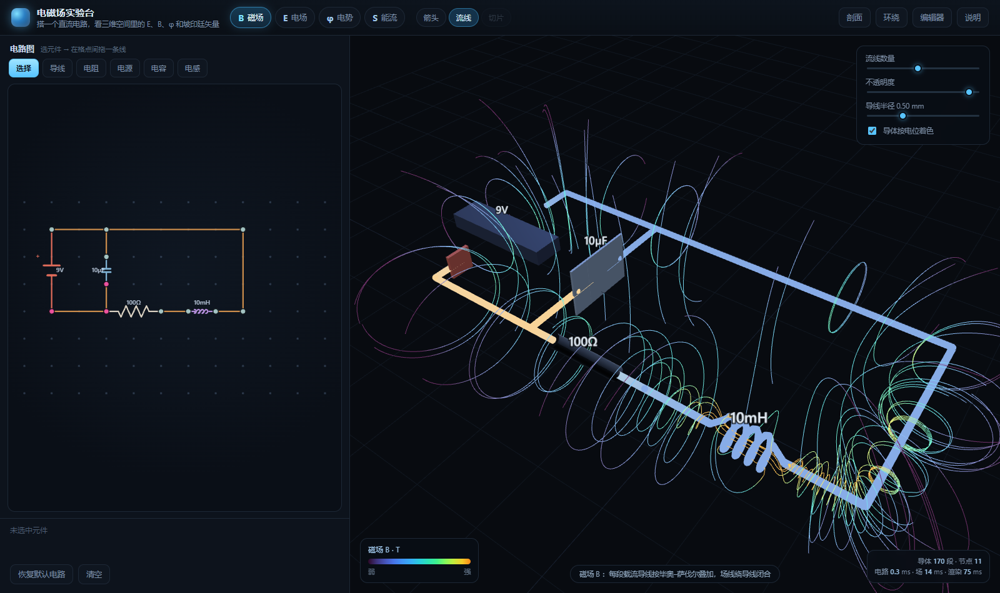
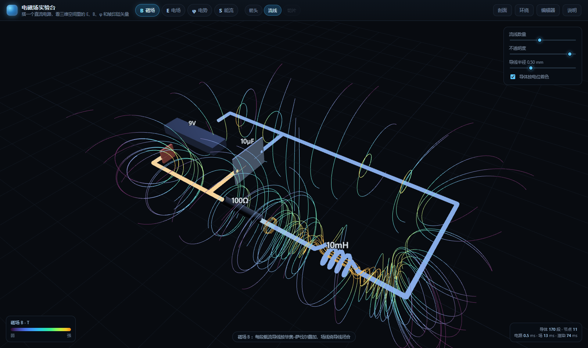
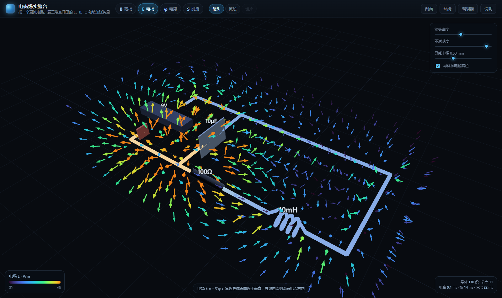
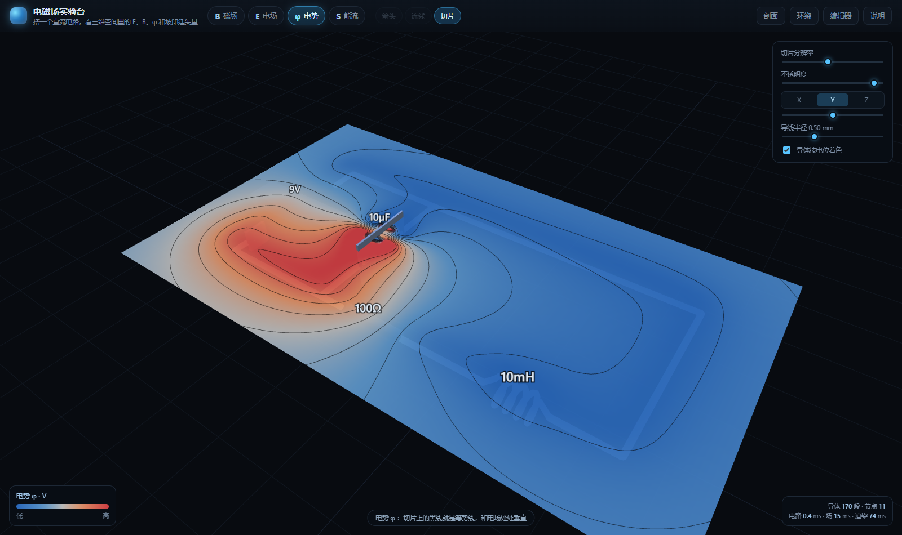
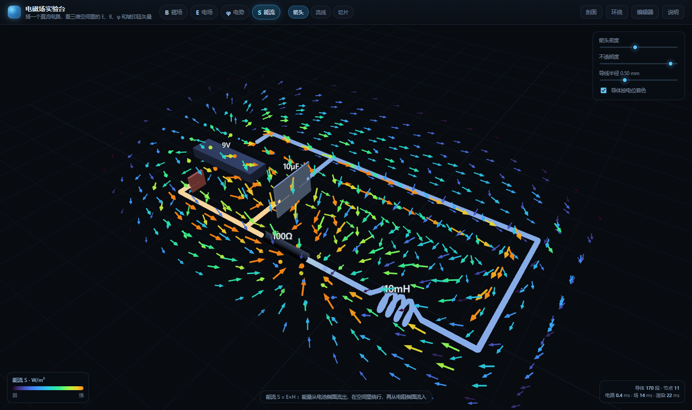
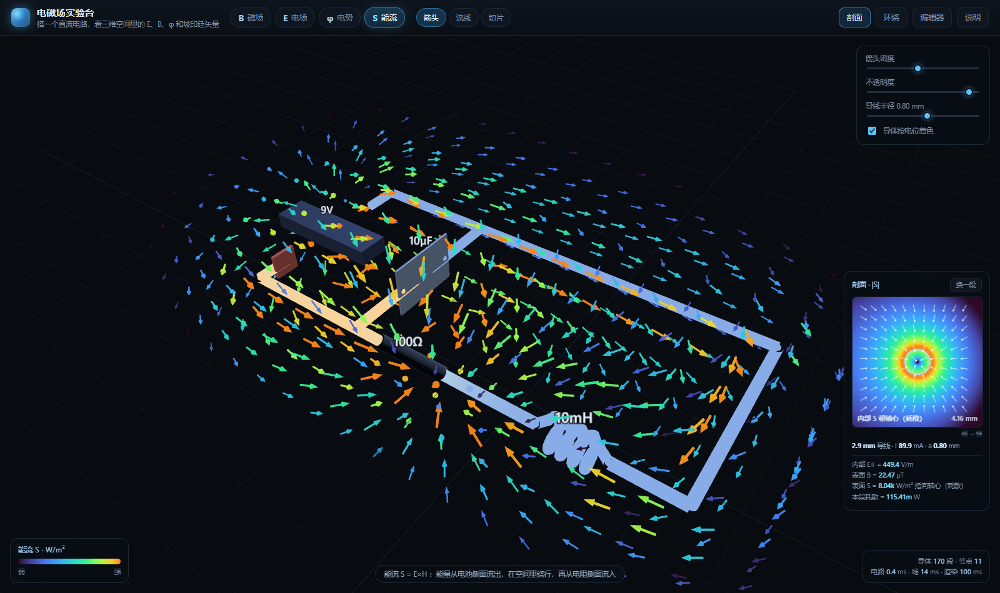

# 电磁场实验台 · EM Field Lab

搭一个直流电路，然后在三维空间里看它的 **电场 E、磁场 B、电势 φ、坡印廷矢量 S**。

左边是用格点画的电路图（导线 / 电阻 / 电源 / 电容 / 电感），右边是自动展开的三维场景：
每个元件按真实几何摆进空间（电感是真的绕成线圈，电容是真的两块极板），
场则是在这个三维空间里逐点算出来的，不是示意图。



## 打开方式

**双击 `em-field-lab.html` 就行** —— 单文件、不用服务器、不用联网、不用装任何东西。

那是因为浏览器对 `file://` 下的 ES module 有跨域限制，所以源码拆成多文件，
但可以用一个小脚本把所有东西（含 three.js）揉进一个 HTML：

```bash
python tools/build_single.py   # → em-field-lab.html（1.4 MB）
```

想改源码的话用多文件版：

```bash
# 双击 start.bat，或
python -m http.server 8765    # 然后开 http://127.0.0.1:8765/
```

## 四个场

| 图 | 说明 |
|---|---|
|  | **磁场 B**：每段载流导线按毕奥–萨伐尔公式精确叠加，场线绕导线闭合 |
|  | **电场 E**：由导体表面电荷产生，`E = −∇φ`。靠近导体表面近乎垂直，导线内部则沿着电流方向 |
|  | **电势 φ**：切片热图 + 等势线，和电场处处垂直 |
|  | **能流 S = E×H**：能量从电池侧面流出、在空间里绕行、再从电阻侧面流入 |

顶部四个 chip 切换要看哪个场，第二排切换显示方式（箭头 / 流线 / 切片）。

## 剖面分析：看清导线内部



点右上角的 **「剖面」**，会在垂直于某段导线的截面上画出 |S|。这是唯一能看清「导体内部」的地方：

- 内部 **E 沿着导线**（电阻里由 `I·R/L` 决定，电源里反向）
- 内部 **B 绕轴**，大小 `μ0·I·r/(2πa²)`，在轴心为 0、表面最大
- 于是 **S = E×B 指向轴心**，这就是导线自身发热的能量来源；在电源段里反过来，指向外侧

卡片上同时给出内部 E∥、表面 B、表面 S 和该段耗散功率，可以和 `I²R` 对账。
「换一段」按钮可以在各导线之间切换。

**导线半径**可以在右侧面板调（0.1–1.4 mm）。调粗之后内部区域才看得见——
这也是为什么这个滑杆和剖面功能是一起加的。

## 怎么用

| 位置 | 操作 | 效果 |
|---|---|---|
| 左侧调色板 | 选工具 → 在格点之间拖一条线 | 放置元件 |
| 左侧 | 「选择」工具点元件 | 下方出现参数滑杆，可改阻值/电压/容值/感值 |
| 左侧 | 右键元件 / 选中后按 `Delete` | 删除 |
| 左侧 | 新端点落在线段中间 | 自动打断，形成 T 形接点 |
| 右侧 | 拖拽 / 滚轮 / 右键拖动 | 旋转 / 缩放 / 平移 |
| 右侧 | 「剖面」 | 打开截面分析卡片 |
| 右侧 | 「环绕」 | 相机缓慢自转 |
| 右侧 | 「编辑器」 | 收起左侧面板，全屏看场 |
| 顶栏 | `1` `2` `3` `4` | 快捷键切换 E / B / φ / S |

链接可以直接分享当前视图，例如：

```
?field=S&mode=arrows&editor=0&analysis=1&wire=8
```

## 物理模型

### 电路：直流工作点

节点法（MNA）解线性方程组，得到每个节点的电位和每条支路的电流。直流约定：

- **导线**：理想导体，但保留 `0.02 Ω` 的微小电阻——**这一点是故意留的**。没有它导线就是等势体，
  导线表面和内部都没有纵向电场，坡印廷矢量也就无从谈起。
- **电感**：直流等效短路（本页给 `0.01 Ω`）。
- **电容**：直流等效开路。两块极板各自停在自己所连节点的电位上，板间因此有静电场，
  电荷量由边界元自洽解出（不是手填的）。
- **电源**：理想电压源。其内部沿本体电势线性上升——这就是 EMF 区，也是能量「被泵出来」的地方。

### 场：边界元 + 解析核

整个页面的关键在**导体表面电荷**。导线周围的电场几乎全部由它决定，而能量怎么流动又由电场和
磁场共同决定。所以不能只拿点电荷往上撒，必须解一个边界积分方程：

把导体离散成线段，设每段电荷密度为未知量 λ，令各段中点电势等于导体电势：

```
Σ_j  k·ln[(r1+r2+L)/(r1+r2−L)] · λ_j  =  V_i
```

这是一条稠密方程组，一次 LU 解出全部 λ，再用「孤立电路净电荷为零」定出整体电位零点。

有了 λ，四个场都是解析求和：

| 量 | 公式 |
|---|---|
| φ | `k·λ·ln[(r1+r2+L)/(r1+r2−L)]` |
| E | `2kλL·(â+b̂)/((r1+r2)²−L²)` |
| B | `μ0I/4π · (a×b)(ra+rb) / [ra·rb·(ra·rb+a·b)]` |
| S | `E×B/μ0` |

三个核都用数值积分验证过（见 `tools/verify_math.py`，误差 ~1e-9）。

### 两个半径

细线边界元要求 **导线半径 ≪ 线段长**，否则方程会病态（实测半径 0.6 mm 配 3.5 mm 线段时，
切向电场误差能到 15 倍）。所以：

- **边界元半径**固定为 0.2 mm，线段长度随之缩放；
- **画面上的导线半径**可以单独调到 1.4 mm，导体内部的场用解析公式单独补上
  （`E = −∂φ/∂l`、`B = μ0Ir/2πa²`），这样剖面里看到的是真的导线内部。

这个近似在导线表面附近会给场带来量级上的偏差，但方向和结构是对的。

## 验证

```bash
python tools/verify_math.py    # 闭式公式 vs 数值积分
node tools/test_core.mjs       # 电路 + 场的核心自检
# 浏览器：?selftest=1          # 24 项端到端检查（编辑/求解/所有渲染组合）
```

`test_core.mjs` 检查的是有物理含义的量，不只是「没报错」：

- 导线附近的 |B| 与无限长导线估算 `μ0I/2πr` 同阶（3.574e-6 vs 3.595e-6 T）
- 边界元解出的净电荷为 0
- **电阻外侧的能流指向导体内部**、**电池外侧的能流指向外部**
- 导体内部 `E∥` 与 `I·R/L`、`B` 与 `μ0I/2πa`、`S` 与功率密度三者互相吻合

## 目录

```
em-field-lab/
├─ em-field-lab.html     打包好的单文件版（双击可用）
├─ index.html            多文件版入口
├─ css/style.css
├─ js/
│  ├─ circuit.js         电路模型、MNA 直流求解、2D→3D 几何展开
│  ├─ field.js           边界元求解 + φ/E/B 求值 + 导体内部解析场
│  ├─ palette.js         配色
│  ├─ editor2d.js        左侧电路图编辑器
│  ├─ scene.js           three.js 场景与元件几何
│  ├─ viz.js             箭头场 / 流线 / 切片 + marching squares 等值线
│  ├─ analysis.js        剖面分析卡片
│  └─ app.js             UI 胶水层 + 自检
├─ lib/                  three.js（本地内置）
├─ tools/                公式验证、核心自检、打包、截图
└─ docs/                 截图
```

## 已知限制

- **只有直流稳态**。交流 / 瞬态没做，所以电感只当短路、电容只当开路。
- 场是**准静态**的：没有位移电流 `∂D/∂t` 和辐射。低频下这个近似很好，高频不行。
- 元件只能摆在水平面上（2D 电路图 → 3D 展开），不能在三维里自由搭。
- 边界元用细线近似，边缘效应只到「几条平行线电荷」的精度；导线加粗后表面附近的场偏强（见「两个半径」）。
- 相机取景是自动的，没有手动「聚焦到某个元件」。

## 下一步

1. **交流 / 瞬态**：复数 MNA + 感生电场 `−∂A/∂t`，把电感电容真正用起来。
2. **时域动画**：FDTD 或半解析的推迟势，能看见场的传播。
3. 若精度不够，再上 **Python 后端 + 有限元/有限差分**（`numpy` 已在，网格求解器另写）。

## 许可

MIT。底层依赖 [three.js](https://threejs.org/)，MIT。
